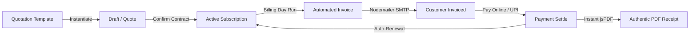

<div align="center">

  

  # Brightloop Software
  ### Enterprise Subscription Billing, Plan Engine & Financial Operations Platform

  <p align="center">
    A unified, production-grade recurring revenue system engineered with Next.js 14, TypeScript, Neon Serverless PostgreSQL, Prisma ORM, and Nodemailer.
  </p>

  <p align="center">
    <a href="https://brightloopsw.vercel.app/"></a>
  </p>

  <p align="center">
    <a href="https://nextjs.org"></a>
    <a href="https://www.typescriptlang.org"></a>
    <a href="https://neon.tech"></a>
    <a href="https://www.prisma.io"></a>
    <a href="https://tailwindcss.com"></a>
    <a href="https://nodemailer.com"></a>
  </p>

</div>

---

## 🚀 Live Demo & Personas (1-Click Switcher)

> **Live Production URL**: [https://brightloopsw.vercel.app/](https://brightloopsw.vercel.app/)

Brightloop is deployed on Vercel and includes a built-in **1-Click Role Switcher** in the top navigation bar, enabling instant evaluation across all operational personas without logging in and out:

| Persona | Role | Credentials | Real-World Capabilities |
| :--- | :---: | :--- | :--- |
| **Elena Rostova** | `ADMIN` | `admin@brightloop.com`<br>`Admin@12345!` | Full system sovereignty: Staff team management, Indian GST tax rules, volume discount tiers, catalog products & brand variants, subscription plan lifecycle policies, and sub-2-second executive finance analytics. |
| **Sarah Jenkins** | `STAFF` | `sarah.sales@brightloop.com`<br>`Staff@12345!` | Operations desk: Instantiate sales quotations from pre-built bundles, confirm customer contracts, run automated Billing Day cycles, record invoice payments across UPI/Cards/NEFT, and dispatch invoices. |
| **Dineesh Kalai** | `CUSTOMER` | `dineeshmkalai@gmail.com`<br>`Customer@12345!` | **Primary Demo Account**: Active Enterprise Annual (`SUB-2026-0005`), Growth Monthly with pause/cancel options, authentic PDF tax invoices, and instant payment settlement receipts. |
| **Alex Lindqvist** | `CUSTOMER` | `alex@nordicretail.com`<br>`Customer@12345!` | Self-service portal: View contract seats, active add-on modules, review billing dates, and download settlement receipts. |

---

## ⚡ Architecture & Subscription Lifecycle



---

## ✨ Core Innovations & Key Features

### 1. 🗂️ Apple-Inspired Collapsible Sidebar
- **Fluid Spring Transitions**: Smooth 64px ↔ 256px expansion with 200ms ease-out transitions and opacity fades that never wrap text. Respects `prefers-reduced-motion`.
- **Keyboard Shortcut**: Press **`[`** anytime to toggle the sidebar, automatically persisted in browser cookies and localStorage.
- **Micro-Interactions**: Custom shadcn Tooltips (150ms delay) on all collapsed navigation icons, 44px touch targets, and accessible `focus-visible` outline rings.
- **Mobile-Native Drawer**: Converts automatically to an off-canvas drawer on screens below 768px.

### 2. 📄 Authentic Vector PDF Invoice & Receipt Engine
- **Indian Banking Standard**: Renders clean currency ISO values (`INR 22,833.00` / `₹`) with zero character corruption.
- **Complete Settlement Breakdown**: Displays itemized product lines, GST rates (18%), volume discounts, balance due, and payment settlement box (Method, Reference Number, Settlement Date).
- **Client-Side Generation**: Generates high-resolution vector PDF downloads instantly using `jsPDF` without external server dependencies.

### 3. ✉️ Production Transactional Email Infrastructure
- **Gmail SMTP Integration**: Production-ready email dispatcher with IPv4-first DNS prioritization to eliminate Windows/Node.js timeout hangs.
- **Connection Pooling & Safety**: Transporter pooling (`maxConnections: 3`), explicit connection timeouts, and Google App Password whitespace sanitization.
- **Branded SaaS HTML Templates**: Responsive email templates featuring the official Brightloop purple infinity badge (`#5638F5`), account summary cards, and direct customer portal CTA buttons.
- **Diagnostic Endpoint**: Built-in `/api/email/test` endpoint for real-time SMTP connectivity health checks.

### 4. 🔄 Autonomous Billing Day Engine
- **Idempotent Billing Runs**: Scans active subscriptions due for renewal (`nextBillingDate <= today`), verifying previous invoices to guarantee no contract is billed twice or missed.
- **Automated Lifecycle Advancement**: Advances billing dates automatically based on interval (`DAILY`, `WEEKLY`, `MONTHLY`, `YEARLY`) and auto-closes expired contracts when configured.
- **Audited Logs**: Every billing execution records timestamped audit entries in `BillingLog` with counts and amounts.

### 5. 🏷️ Multi-Variant Catalog & Pricing Rules
- **Product Types**: Supports `SOFTWARE`, `SERVICE`, `ADDON`, and `MODULE`.
- **Brand Add-On Variants**: Configure variant premiums (e.g. *Odoo Brand Edition adds ₹560*, *Enterprise Cloud adds ₹2,500*).
- **Flexible Billing Schedules**: Configure minimum seat quantities, availability dates, and granular policy toggles (*Auto-close*, *Allow early close*, *Allow pause*, *Allow renewal*).
- **Automated Discount Rules**: Tiered volume discounts and promotional percentages applied automatically during invoice generation.

### 6. 📊 Sub-2-Second Executive Finance Dashboard
- Single-pass parallel SQL aggregations returning comprehensive analytics in under 20ms:
  - **MRR (Monthly Recurring Revenue)** & **ARR (Annual Recurring Revenue)** normalized across all billing frequencies.
  - Active contract counts, cash revenue collected, and pending receivables.
  - Overdue invoice queue with 1-click payment settlement.
  - Interactive Recharts visualization for revenue trends and plan distributions.

---

## 🛠️ Tech Stack

| Layer | Technology |
| :--- | :--- |
| **Frontend & SSR** | Next.js 14 (App Router), React 18, Tailwind CSS |
| **Language** | TypeScript 5.6 (Strict Type Safety) |
| **Database** | Neon Serverless PostgreSQL (Connection Pooling + Direct Migration URLs) |
| **ORM** | Prisma ORM 5.22 |
| **Email Dispatch** | Nodemailer (Gmail SMTP, Connection Pooling, IPv4 Priority) |
| **PDF Generation** | jsPDF (Vector Invoices & Receipts) |
| **Authentication** | Custom JWT Sessions, HTTP-Only Cookies, bcrypt Password Hashing |
| **Validation** | Zod Schema Validation |
| **Visualizations** | Recharts Data Visualization Suite |

---

## 💻 Getting Started Locally

### 1. Prerequisites
- **Node.js** v18+ or v20+
- **npm** or **pnpm**
- A free **Neon Serverless PostgreSQL** database

### 2. Installation & Setup
```bash
# Clone the repository
git clone https://github.com/dineesh07/BrightLoop.git
cd BrightLoop

# Install dependencies
npm install
```

### 3. Environment Variables
Create a `.env` file in the project root:
```env
# Database Connection (Neon Serverless PostgreSQL)
DATABASE_URL="postgresql://[user]:[password]@[neon-pooler-hostname]/neondb?sslmode=require&channel_binding=require"
DIRECT_URL="postgresql://[user]:[password]@[neon-direct-hostname]/neondb?sslmode=require&channel_binding=require"

# JWT Authentication Secret
JWT_SECRET="brightloop_super_secret_jwt_key_2026_subscription_system"

# Application Settings
NEXT_PUBLIC_APP_NAME="Brightloop Software"
NEXT_PUBLIC_APP_URL="https://brightloopsw.vercel.app" # Or http://localhost:3000 locally

# Nodemailer SMTP Configuration
SMTP_HOST="smtp.gmail.com"
SMTP_PORT="465"
SMTP_USER="your-email@gmail.com"
SMTP_PASS="your-16-char-app-password"
SMTP_SECURE="true"
EMAIL_FROM="Brightloop Software <your-email@gmail.com>"
```

### 4. Database Setup & Seeding
```bash
# Generate Prisma Client & push schema to Neon
npx prisma generate
npx prisma db push

# Seed realistic demo data (Products, Variants, Plans, Subscriptions, Invoices, Payments)
npm run prisma:seed
```

### 5. Run the Application
```bash
# Start local development server
npm run dev

# Or build for production
npm run build
npm start
```
Open **[http://localhost:3000](http://localhost:3000)** in your browser.

---

## 🧪 Testing & Verification Endpoints

- **SMTP Health Check**: `GET /api/email/test` — Verifies SMTP connection and authentication credentials.
- **Dispatch Test Welcome Email**: `POST /api/email/test` with payload `{"email": "your-email@example.com", "name": "Test User"}`.
- **Type Checking**: `npx tsc --noEmit` verifies strict TypeScript safety with 0 errors.

---

<div align="center">
  <p><sub>Built with precision for Brightloop Software &bull; 2026 Enterprise Edition</sub></p>
</div>
